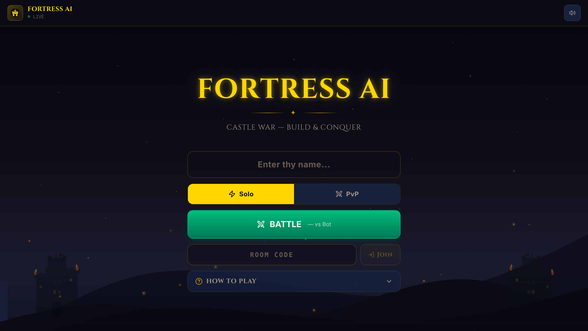
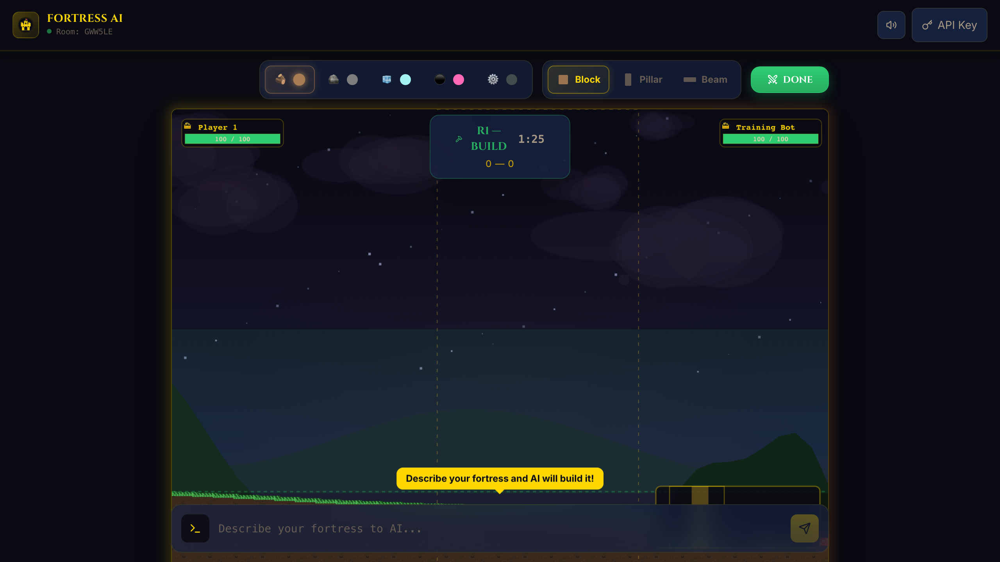
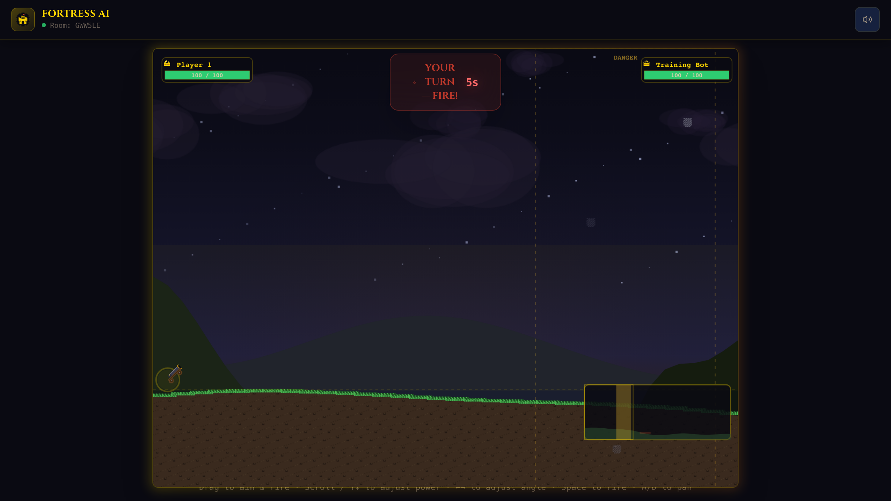

<p align="center">
  
</p>

<h1 align="center">Fortress AI</h1>

<p align="center">
  <strong>Build fortresses with AI. Destroy them with physics.</strong>
</p>

<p align="center">
  Real-time multiplayer 2D artillery game where players describe fortresses in plain English, AI builds them, and turn-based cannon combat tears them apart.
</p>

<p align="center">
  <a href="https://www.fortressbattle.com"><strong>Play Now</strong></a>
</p>

<p align="center">
  
  
  
  
  
  
  
</p>

---

<p align="center">
  
  
  
</p>

## How It Works

1. **Build** (90s) — Describe your fortress to AI or place blocks manually. Five materials: wood, stone, ice, rubber, steel.
2. **Reveal** (5s) — Camera pans across the battlefield. Environmental hazards are shown.
3. **Combat** — Take turns firing your cannon. Physics simulation handles collisions, destruction, and debris.
4. **Best of 3** — Destroy the enemy King to win a round. First to 2 rounds wins.

## Features

- **AI Fortress Builder** — Describe any structure in plain English. Gemini 2.5 Flash generates up to 50 physics blocks with material-aware placement.
- **5 Materials** — Wood, stone, ice, rubber, steel. Each with unique density, friction, bounce, and HP.
- **Illustrated Battlefield** — Layered scenery, continuous textured terrain, distinct royal characters, articulated king gestures and material-specific effects.
- **Environmental Hazards** — Wind zones push projectiles. Lava pools deal continuous damage. Falling rocks threaten both sides.
- **Multiplayer** — Private rooms with shareable invite links, matchmaking queue, or solo vs bot.
- **Sound** — Synthesized combat effects, a once-per-visit menu welcome and a lazy-loaded instrumental loop, all following the global mute control.
- **Mobile Ready** — Touch aiming, responsive layout, works in portrait and landscape.

## Quick Start

```bash
# Install
npm install
cd server && npm install && cd ..

# Configure
cp server/.env.example server/.env
# Set GEMINI_API_KEY in server/.env

# Run (two terminals)
cd server && npm run dev    # Backend on :3001
npm run dev                 # Frontend on :5173
```

Open [localhost:5173](http://localhost:5173). Both servers must run simultaneously.

## Tech Stack

| | Technology |
|---|---|
| **Frontend** | React 19, Vite, TypeScript, Tailwind CSS 4, Zustand |
| **Rendering** | Canvas 2D, layered illustrated art, registered cutout rigs, pooled particles |
| **Backend** | Express 5, Socket.io, TypeScript |
| **Physics** | Matter.js — server-authoritative, 60Hz simulation, 20Hz delta-encoded broadcast |
| **AI** | Google Gemini 2.5 Flash — structured JSON output, Zod schema validation |
| **Testing** | Playwright — game flow, performance, visual regression, mobile viewport |

## Architecture

```
Client (React + Canvas 2D)          Server (Express + Matter.js)
┌─────────────────────┐            ┌──────────────────────────┐
│  GameCanvas.tsx      │◄──20Hz───│  GameLoop (60Hz physics)  │
│  - Sprite rendering  │  Socket  │  - Matter.js engine       │
│  - Interpolation     │  .io     │  - Collision detection    │
│  - Particles/FX      │          │  - Damage calculation     │
│                      │──events─►│                           │
│  useGameState.ts     │          │  MatchStateMachine        │
│  - State sync        │          │  BUILD→REVEAL→COMBAT→RESULT│
│  - Delta decoding    │          │                           │
└─────────────────────┘           │  Gemini AI Pipeline       │
                                  │  prompt→schema→spawn      │
                                  └──────────────────────────┘
```

The server owns all physics. The client is a renderer — it receives delta-encoded snapshots and draws them with interpolation. No client-side prediction.

### AI Pipeline

1. Player submits a natural language prompt
2. Server calls Gemini 2.5 Flash with terrain-aware system prompt
3. Response validated against Zod schema (max 50 blocks, bounded coordinates)
4. AABB collision resolution shifts overlapping blocks
5. Validated blocks spawned into the physics world

## Project Structure

```
src/
  components/        React UI — GameCanvas, Lobby, PhaseOverlay, Chat, GodTools
  hooks/             useGameState — Socket.io connection + all game state
  sprites/           SpriteLoader + AnimatedSprite (frame-based animations)
  effects/           Particle system — material-specific, pool-based, zero-alloc
  audio/             Procedural Web Audio API sound effects
  analytics/         Lightweight event tracking via sendBeacon
  debug/             Real-time FPS/network/memory overlay (` key or ?debug=1)

server/
  game/              RoomManager, GameSession, MatchStateMachine, BotAI, ScoreManager
  physics/           Matter.js world, 60Hz loop, terrain generation, hazards
  ai/                Gemini integration, Zod schemas, system prompts, overlap resolution
  analytics/         Event ingestion + /api/stats endpoint

scripts/
  generate-sprites.ts   Procedural pixel art generator (39 PNGs)
```

## Environment Variables

| Variable | Description | Default |
|----------|-------------|---------|
| `GEMINI_API_KEY` | Google Gemini API key | Required |
| `PORT` | Server port | `3001` |
| `ALLOWED_ORIGINS` | CORS whitelist (comma-separated) | `localhost` |
| `ADMIN_KEY` | Auth for `/api/stats` | Optional |
| `VITE_SERVER_URL` | Frontend build: public Socket.io backend origin | Current hostname on port `3001`; configure for hosted frontend/backend separation |

## Commands

| Command | Description |
|---------|-------------|
| `npm run dev` | Vite dev server |
| `npm run build` | Production build (TypeScript + Vite) |
| `npm run lint` | ESLint |
| `npm run generate:sprites` | Regenerate all 39 pixel art sprites |
| `npm run test:e2e` | Playwright E2E tests |
| `npm run test:e2e:headed` | Tests with visible browser |
| `npm run test:game` | Focused rendering, animation, audio and snapshot tests |
| `npm run prepare:king-action-qa` | Render registered king action clips at full and runtime sizes |

## Security

- CORS locked to explicit allowed origins
- API keys never forwarded in error messages
- Socket.io message size capped (100KB)
- AI prompts sanitized (500 char limit, control chars stripped)
- Analytics rate-limited (20 req/min per IP)
- Player names sanitized server-side (20 chars, alphanumeric)
- Input validation on all game events (bounds, NaN, Infinity checks)
- Zod schema validation on all AI responses

## Contributing

Contributions welcome. Please open an issue first to discuss what you'd like to change.

1. Fork the repo
2. Create your branch (`git checkout -b feature/my-feature`)
3. Commit your changes
4. Push to the branch (`git push origin feature/my-feature`)
5. Open a Pull Request

## License

[MIT](LICENSE)
